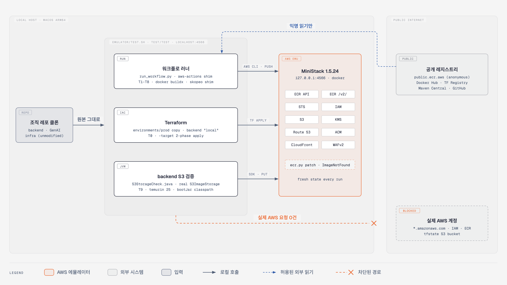
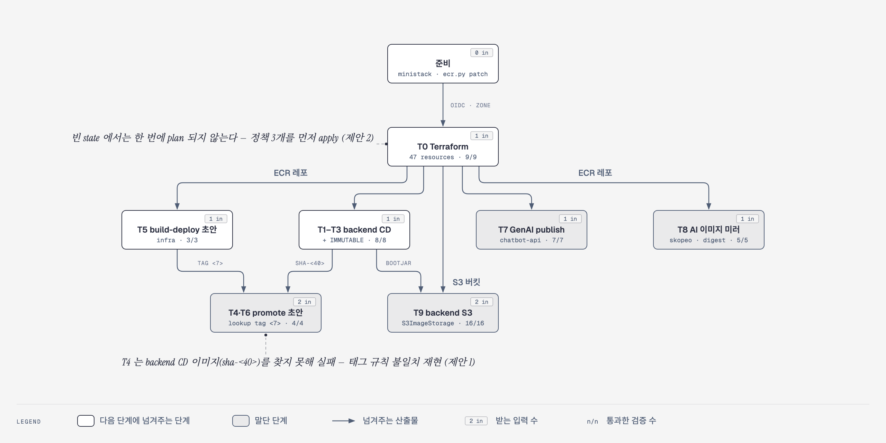

# ☁️ AWS 접점 에뮬레이터 검증 (midam-improve)

<h3 align="center">실제 AWS 없이, 원본 코드 그대로 검증한 CI/CD · Terraform · S3</h3>

<p align="center">
  jangingmall 조직 레포(backend · GenAI · infra)의 <strong>ECR 배포 파이프라인 · prod Terraform · 런타임 S3</strong>를<br>
  로컬 AWS 에뮬레이터 <strong>MiniStack</strong> 위에서 돌려 보고, 찾은 문제와 개선안을 기록한 레포입니다.
</p>

<p align="center">
  <strong>MiniStack 1.5.24 · Terraform 1.16.5 · AWS CLI v2 · Docker Buildx · skopeo · AWS SDK for Java v2 · Python 워크플로 러너</strong>
</p>

---

## 📑 목차

1. [한눈에 보기](#overview)
2. [검증 아키텍처](#architecture)
3. [검증 흐름](#flow)
4. [검증 대상](#targets)
5. [결과](#results)
6. [발견한 문제와 개선 제안](#findings)
7. [테스트 도구와 환경](#tooling)
8. [GitHub Actions 실행 방식](#actions)
9. [에뮬레이터의 한계](#emulator-limits)
10. [안전장치](#safety)
11. [실행 방법](#getting-started)
12. [하네스를 만들며 겪은 문제와 대응](#troubleshooting)
13. [프로젝트 구조](#structure)
14. [알려진 제한](#limits)

<br>

<a id="overview"></a>

## 🧭 한눈에 보기

| 항목 | 내용 |
|---|---|
| 대상 | jangingmall `backend` · `GenAI` · `infra`. `frontend` 는 AWS 를 직접 부르지 않아 제외 |
| 범위 | ECR 배포 파이프라인 5종, prod Terraform 일부(리소스 47개), backend 런타임 S3 |
| AWS | 로컬 Docker 의 MiniStack 컨테이너(`127.0.0.1:4566`). **실제 AWS 계정에는 요청 0건** |
| 결과 | **52 passed / 0 failed** (마지막 전체 실행 2026-10-10, 약 5분) |
| 발견 | 조직 레포 개선 제안 5건, 에뮬레이터 결함 1건(로컬 패치) |
| 조직 레포 변경 | 없음. 이 레포는 하네스와 기록만 담습니다 |

이 검증이 지키는 원칙은 세 가지입니다.

1. **실제 AWS 에는 닿지 않습니다.** 가짜 자격증명과 로컬 엔드포인트만 쓰고, 실제 Terraform state 버킷도 열지 않습니다.
2. **원본을 그대로 돌립니다.** 워크플로 `run:` 스텝 · 셸 스크립트 · Terraform · backend S3 코드는 원문 그대로 실행합니다. 에뮬레이터로 대신할 수 없는 부분만 shim 으로 바꾸고 그 목록을 남깁니다.
3. **조직 레포는 고치지 않습니다.** 찾은 문제는 개선안으로만 기록합니다.

<br>

<a id="architecture"></a>

## 🏗️ 검증 아키텍처

<p align="center">
  
</p>

모든 AWS 호출은 **로컬 호스트 안의 MiniStack** 에서 끝납니다.

- **도구 3개:** 워크플로 러너(T1–T8), Terraform(T0), backend S3 검증(T9)이 `test.sh` 가 고정한 환경(`test`/`test` 자격증명, `localhost:4566` 엔드포인트)에서 조직 레포 원본을 실행합니다.
- **허용된 외부 접속:** 공개 레지스트리의 익명 읽기뿐입니다(T8 원본 이미지, 컨테이너 이미지, 프로바이더, Gradle 의존성).
- **차단된 경로:** 실제 AWS 계정으로 가는 경로는 로컬 경계에서 끊깁니다. 실제 AWS 요청은 0건입니다 ([안전장치](#safety)).
- 다이어그램 원본은 [`docs/images/architecture.html`](docs/images/architecture.html)(인라인 SVG)이며, 고친 뒤 SVG 영역을 PNG 로 다시 내보내 `architecture.png` 를 바꿉니다.

<br>

<a id="flow"></a>

## 🔄 검증 흐름

`./emulator/test.sh` 한 번이 아래 순서로 실행합니다. 화살표는 앞 단계가 다음 단계에 넘겨주는 산출물입니다.

<p align="center">
  
</p>

- **준비:** MiniStack 을 새로 띄우고 `ecr.py` 를 패치합니다(없는 태그 → `ImageNotFoundException`). infra OIDC 부트스트랩 스크립트를 두 번 돌리고(2회차는 건너뛰어야 함), Route 53 호스팅 존을 만듭니다.
- **T0:** 빈 state plan 실패를 확인한 뒤 IAM 정책 3개 → 나머지 순서로 두 번 apply 하고, 재plan 이 변경 없음인지 봅니다.
- **T4·T6:** 두 갈래 입력을 받습니다. infra 초안(T5)이 올린 `<7자리>` 이미지는 승격되고, backend CD(T1)가 올린 `sha-<40자리>` 이미지는 찾지 못합니다.
- T0 이 만든 ECR 레포 · S3 버킷을 T1–T9 가 그대로 씁니다. T9 는 T1 이 빌드한 JAR 를 클래스패스로 씁니다.
- 다이어그램 원본은 [`docs/images/pipeline.html`](docs/images/pipeline.html) 입니다.
- 매 실행마다 에뮬레이터와 Terraform state 를 새로 만듭니다. 이전 실행의 상태에 기대지 않습니다.
- 시나리오별 스텝 로그와 결과 JSON 은 `emulator/out/<ID>.log` · `<ID>.json` 에 남습니다.

<br>

<a id="targets"></a>

## 🎯 검증 대상

| 레포 | 브랜치 · 커밋 | 다룬 범위 |
|---|---|---|
| backend | develop · `b54bf64` | `.github/workflows/cd.yml` (ECR push), 런타임 S3 (`ImageStorageConfig` · `S3ImageStorage`) |
| GenAI | main · `1581553` | `.github/workflows/genai-ci.yml` `publish` job (chatbot-api leg) |
| infra | main · `777a8e4` | `terraform/environments/prod` 일부, `ai-image-mirror.yml` + `scripts/mirror-ai-image.sh`, `ci-cd/` 초안 2개, `scripts/bootstrap-github-oidc.sh` |
| frontend | dev · `85a74c1` | 없음. AWS 접점이 BE 가 서명한 presigned URL 뿐이고, 에뮬레이터가 CORS 를 평가하지 않음 |

<br>

<a id="results"></a>

## 📊 결과

| ID | 시나리오 | 검증 | 결과 |
|---|---|---|---|
| T0 | infra Terraform → MiniStack apply (리소스 3 + 44개), 재plan 변경 없음, 생성 설정 확인 | 9 | ✅ |
| T1 | backend CD, 새 SHA: 실제 JAR 빌드 → 실제 이미지 push, 워크플로 digest == ECR digest | 3 | ✅ |
| T2 | backend CD 재실행: 기존 태그 감지 → 빌드 건너뜀, 같은 digest | 3 | ✅ |
| T3 | IMMUTABLE: 같은 태그에 다른 이미지 push 거부, digest 불변 | 2 | ✅ |
| T4 | infra promote 초안 × backend CD 이미지: 태그 규칙 불일치로 실패 (재현) | 1 | ✅ |
| T5 | infra build-deploy 초안: `batch-get-image` 로 신규 판정 → push | 3 | ✅ |
| T6 | infra promote 초안: staging 검증 digest 일치 시 승격 후보 생성 / 불일치 시 실패 | 3 | ✅ |
| T7 | GenAI publish: 역할 변수 없으면 AWS 인증 전 실패 / 신규 push / 재실행 시 재사용 | 7 | ✅ |
| T8 | AI 이미지 미러: 태그 입력 거부 / 멀티아키 digest 보존 복사 / 재실행 멱등 | 5 | ✅ |
| T9 | backend 런타임 S3: 실제 `ImageStorageConfig` + `S3ImageStorage` × Terraform 이 만든 버킷 | 16 | ✅ |

### T0 Terraform 이 만든 것

`module.ecr`(ECR 5개), `module.github_oidc*`(OIDC 역할 3개 + IAM 정책 3개), `module.s3_returns`(+ `module.kms_app`),
`module.s3_images`(+ `module.s3_access`, 버킷 정책이 참조하는 CloudFront · ACM(us-east-1) · WAF · Route 53 검증 레코드).
변수는 `terraform.tfvars.example`, Route 53 호스팅 존은 에뮬레이터에 미리 만들어 ID 를 넘겼습니다.

### T9 S3 검증 15개 (+ 실행 완료 1개)

- presigned URL 이 에뮬레이터의 공개 버킷을 가리킴 · presigned PUT `200`
- `isValid` 통과 / 크기 초과 `false` / Content-Type 불일치 `false` / 없는 객체 `false`
- `exists` true · false, 서버 측 `put`, `delete`
- RETURN 은 반품 버킷으로 서명 · 반품 버킷 PUT `200` · 반품 객체 `aws:kms` 암호화 · 반품 객체가 공개 버킷에 없음
- 서명과 다른 Content-Type 으로 PUT `403` · 서명을 변조한 URL 로 PUT `403`

<br>

<a id="findings"></a>

## 🔍 발견한 문제와 개선 제안

조직 레포에는 아직 반영하지 않았습니다. 제안 코드는 에뮬레이터에서 다시 돌려 보지 않았습니다.

| # | 위치 | 문제 | 영향 | 제안 |
|---|---|---|---|---|
| 1 | infra `ci-cd/promote.yml` · `build-deploy.yml` ↔ backend `cd.yml` | 태그 규칙 불일치. backend CD 는 `sha-<40자리>`, infra 초안은 `<7자리>`, GenAI 는 `<40자리>` | 초안을 그대로 붙이면 backend 이미지 승격이 `ImageNotFoundException` 으로 실패 (T4 재현) | 조직 공통 규칙 하나로 통일 (예: backend CD 의 `sha-<40>`) 후 infra 초안 수정 |
| 2 | infra `terraform/modules/github_oidc/main.tf:55` | `for_each = toset(var.policy_arns)` 가 아직 생성 전인 정책 ARN 에 의존 | 빈 state 에서 prod 가 한 번에 plan 안 됨 (`Invalid for_each argument`). **새 정책 + 새 역할을 한 PR 로 추가할 때도 같음** | [제안 2](#proposal-2) |
| 3 | backend `cd.yml` `ecr-check` 스텝 else 분기 | `exit "${STATUS}"`. CLI 가 0 으로 끝났는데 digest 가 비면 `exit 0` | 스텝 성공 + `exists` 출력 없음 → push 스텝 skip → **이미지 없이 job 초록** (fail-open). 실제 ECR 에서는 이 경로에 안 들어가는 잠재 결함이며, 에뮬레이터 패치 전에 실제로 재현됨 | [제안 3](#proposal-3) |
| 4 | backend `cd.yml` 스텝 순서 | 테스트 · JAR 빌드가 ECR 존재 확인보다 먼저 | 이미 올라간 SHA 를 재실행해도 테스트 · 빌드 비용을 전부 냄 | 인증 · 존재 확인을 앞으로 옮기고 테스트 · 빌드에 `if: steps.ecr-check.outputs.exists == 'false'` (infra `build-deploy.yml` 초안이 이미 이 순서) |
| 5 | backend `S3ImageStorageTest` | `S3Client` · `S3Presigner` 를 mock 으로만 검증 | presigned URL 서명, HeadObject 메타데이터, 404 처리가 테스트에서 실행되지 않음 | 코드 수정 없이 `AWS_ENDPOINT_URL_S3` 만으로 에뮬레이터에 붙는 것을 확인 (T9). 필요하면 통합 테스트로 이식 |

<a id="proposal-2"></a>

### 제안 2 · github_oidc `for_each`

키를 plan 시점에 정해지는 정적 문자열로 바꿉니다.

```hcl
# modules/github_oidc/variables.tf
variable "policy_arns" {
  description = "이 Role에 붙일 정책 ARN (키는 정적 이름)"
  type        = map(string)
}

# modules/github_oidc/main.tf
resource "aws_iam_role_policy_attachment" "this" {
  for_each   = var.policy_arns
  role       = aws_iam_role.this.name
  policy_arn = each.value
}

# environments/prod/github_oidc.tf
policy_arns = { ecr = aws_iam_policy.gha_backend_ecr.arn }                                         # backend
policy_arns = { ecr = aws_iam_policy.gha_genai_ecr.arn, models_s3 = aws_iam_policy.gha_genai_models_s3.arn } # genai
```

기존 state 의 attachment 주소가 `["<ARN>"]` → `["ecr"]` 로 바뀌어 plan 에 교체가 나옵니다. `moved` 블록은 ARN(계정 ID 포함)을 코드에 적어야 해서 infra 규칙 2번과 충돌합니다. 적용 방식은 infra 담당이 정해야 합니다.

<a id="proposal-3"></a>

### 제안 3 · backend `cd.yml`

```diff
           else
             echo "${RESULT}" >&2
-            exit "${STATUS}"
+            exit 1
           fi
```

<br>

<a id="tooling"></a>

## 🧰 테스트 도구와 환경

### 실행 환경

| 구분 | 도구 | 버전 |
|---|---|---|
| 호스트 | macOS (Apple Silicon) | 27.0.1 · arm64 |
| 컨테이너 | Docker Desktop (buildx 포함) | 4.83.0 (client 29.6.2) |
| AWS 에뮬레이터 | `ministackorg/ministack` | 1.5.24 |
| AWS 클라이언트 | AWS CLI v2 | 2.37.11 |
| IaC | Terraform / `hashicorp/aws` / `hashicorp/tls` | 1.16.5 / 5.100.0 / 4.4.1 |
| 레지스트리 복사 | skopeo | 1.24.1 |
| 워크플로 러너 | `emulator/run_workflow.py` (자체 제작) | Python 3.14.3 · PyYAML 6.0.3 |
| 판정 | bash · jq | jq 1.7.1 |
| Java | `eclipse-temurin:25-jdk-noble` 컨테이너 (프로젝트가 JDK 25 요구, 호스트는 26) | 25 |
| backend 런타임 | Spring Boot / AWS SDK for Java v2 BOM | 4.0.3 / 2.54.13 |
| 스텁 이미지 | `busybox` | 1.36 |

### MiniStack 이 대신한 AWS 서비스

| AWS 서비스 | 호출한 쪽 | 테스트 |
|---|---|---|
| ECR API (`DescribeImages` · `BatchGetImage` · `GetAuthorizationToken` · 레포 · 정책) | Terraform, 워크플로 `run:` 스텝의 AWS CLI, 액션 shim | T0–T8 |
| ECR 레지스트리 (Docker Registry V2, 같은 포트의 `/v2/`) | `docker buildx` push, `docker push`, skopeo copy | T1–T8 |
| STS `AssumeRoleWithWebIdentity` | `configure-aws-credentials` shim (AWS CLI) | T1–T8 |
| IAM (OIDC 공급자 · 역할 · 정책) | `bootstrap-github-oidc.sh` (AWS CLI), Terraform | T0 |
| S3 (버킷 · 정책 · 암호화 · 객체) | Terraform, AWS SDK `S3Client` · `S3Presigner`, `java.net.http` PUT | T0 · T9 |
| KMS | Terraform (반품 버킷 키) | T0 · T9 |
| Route 53 | AWS CLI (호스팅 존), Terraform (ACM 검증 레코드) | T0 |
| ACM (us-east-1) · CloudFront (+OAC) · WAFv2 | Terraform | T0 |

### 테스트별 실행 방법

| ID | 원본 | 실행 방법 | 대체 · 생략한 것 |
|---|---|---|---|
| T0 | infra `terraform/environments/prod` | `emulator/.work/` 로 복사 후 override 파일(local 백엔드, 프로바이더 엔드포인트 → MiniStack)로 `terraform init/plan/apply` | `-target` 2단계, 변수는 `terraform.tfvars.example`, Route 53 존은 에뮬레이터에 생성 |
| T1 · T2 | backend `cd.yml` `build-and-push` | `run:` 스텝을 원문 그대로 bash 로 실행. JAR 빌드는 temurin 25 컨테이너, 이미지는 실제 `docker buildx build --push` | `./gradlew test` 생략. 액션 3개 shim |
| T3 | ECR IMMUTABLE 설정 | busybox 이미지를 같은 태그로 `docker push` | — |
| T4 · T6 | infra `ci-cd/promote.yml` (초안) | `run_workflow.py` | GitOps 체크아웃 · 편집 스텝은 초안 조건상 미실행 |
| T5 | infra `ci-cd/build-deploy.yml` (초안) | `run_workflow.py --stub-build` | 테스트 명령 `true`, 이미지는 busybox 스텁 |
| T7 | GenAI `genai-ci.yml` `publish` | `run_workflow.py --stub-build`, matrix `service=chatbot-api` | 다른 leg, `test` · `docker-validate` job, `Check runner storage` 생략. 이미지는 스텁 |
| T8 | infra `ai-image-mirror.yml` + `scripts/mirror-ai-image.sh` | 스크립트가 부르는 실제 skopeo 앞에 PATH shim 을 둬 대상 호스트만 `localhost:4566` 으로 바꾸고 TLS 검증을 끔. 원본은 `public.ecr.aws/aws-cli/aws-cli@<digest>` | apt 로 skopeo 설치하는 스텝 생략 (brew 설치본 사용) |
| T9 | backend `ImageStorageConfig` + `S3ImageStorage` | `S3StorageCheck.java` 를 temurin 25 컨테이너에서 실행. 클래스패스는 T1 의 bootJar 레이어, 접속은 `AWS_ENDPOINT_URL_S3` 환경변수만으로 | Spring 앱 전체(컨트롤러 · DB · 인증)는 띄우지 않고 S3 빈만 구성 |

<br>

<a id="actions"></a>

## 🤖 GitHub Actions 실행 방식

`emulator/run_workflow.py` 가 워크플로 YAML 의 job 하나를 로컬에서 실행합니다. `${{ }}` 식 평가, 스텝 `if:`, 스텝 출력, matrix leg 선택을 지원하고, `run:` 스텝은 원문 그대로 bash 로 돌립니다.

| 액션 | 처리 |
|---|---|
| `actions/checkout` · `setup-java` · `setup-python` · `cache` · `upload-artifact` · `docker/setup-buildx-action` | 아무것도 안 함 (로컬 클론과 호스트 도구 사용) |
| `aws-actions/configure-aws-credentials` | shim: 서명 없는 가짜 JWT 로 `aws sts assume-role-with-web-identity` → 받은 키를 이후 스텝 환경변수로 |
| `aws-actions/amazon-ecr-login` | shim: `aws ecr get-authorization-token` → `docker login localhost:4566`, 출력 `registry=localhost:4566` |
| `docker/build-push-action` | shim: `docker buildx build [--push] --metadata-file` → `digest` 출력. `--stub-build` 면 busybox 기반 스텁 이미지 |

[nektos/act](https://github.com/nektos/act) 를 쓰지 않은 이유는 세 가지입니다.

- GitHub OIDC 토큰이 없습니다.
- `amazon-ecr-login` 이 `*.amazonaws.com` 레지스트리로 고정돼 있습니다.
- 무거운 비-AWS 스텝(`./gradlew test` 등)을 명시적으로 건너뛰고 그 사실을 결과에 남길 방법이 필요했습니다.

<br>

<a id="emulator-limits"></a>

## 🧪 에뮬레이터의 한계

| 항목 | 실제 AWS | MiniStack 1.5.24 | 이 하네스의 처리 |
|---|---|---|---|
| ECR `DescribeImages` 없는 태그 | `ImageNotFoundException` | 빈 목록 + exit 0 | 컨테이너 안 `ecr.py` 패치 (`assert` 로 업스트림 변경 감지). 업스트림 이슈 후보 |
| STS `AssumeRoleWithWebIdentity` | 토큰 · 역할 · 신뢰 정책(`sub`) 검증 | 검증 안 함 | 신뢰 정책은 문서 내용만 확인 (T0) |
| IAM 권한 · 버킷 정책 | 강제 | 저장만 함 (`AUTH=true` 미시도) | 최소 권한, TLS 강제는 미검증 |
| 버킷 CORS | Origin 평가 | 모든 Origin 허용 | FE 브라우저 업로드 CORS 미검증 |
| presigned URL 서명 | 검증 | **검증함** (`403`) | T9 에서 확인 |
| ECR IMMUTABLE | 강제 | **강제함** | T3 에서 확인 |

<br>

<a id="safety"></a>

## 🛡️ 안전장치

- 가짜 자격증명(`test` / `test`), `AWS_ENDPOINT_URL=http://localhost:4566`, `AWS_CONFIG_FILE` · `AWS_SHARED_CREDENTIALS_FILE=/dev/null`, `AWS_PROFILE` 해제.
- `run_workflow.py` 는 엔드포인트가 localhost 가 아니면 실행을 거부합니다.
- 레지스트리 호스트(`<계정>.dkr.ecr.<리전>.amazonaws.com`)는 `localhost:4566` 으로 바꿔 접속합니다 (액션 shim, skopeo PATH shim).
- Terraform 은 `infra/terraform` 을 `emulator/.work/` 로 복사하고 override 파일로 **local 백엔드** + MiniStack 프로바이더를 씁니다. 백엔드가 local 이 아니면 plan 전에 멈춥니다.
- `S3StorageCheck` 는 에뮬레이터가 아닌 URL 로 PUT 하지 않고, HTTPS 는 죽은 프록시로 보냅니다.
- 계정 ID 는 코드 · 문서에 적지 않고 backend `cd.yml` 의 역할 ARN 에서 실행 시 읽습니다. 실행 로그(`emulator/out/`)와 state(`emulator/.work/`)에는 찍히므로 Git 에 넣지 않습니다.

모든 AWS 클라이언트의 자격증명이 `test` / `test` 이므로, 요청이 실제 AWS 에 닿았다면 인증 실패로 해당 테스트가 깨졌을 것입니다.

### 외부 네트워크 접속

AWS 자격증명을 실어 보낸 곳은 없습니다.

| 대상 | 용도 |
|---|---|
| github.com (`jangingmall/*`) | 레포 클론 |
| Docker Hub | MiniStack · temurin · busybox 이미지 |
| Terraform Registry | 프로바이더 다운로드 |
| Gradle 저장소 (Maven Central 등) | backend JAR 빌드 의존성 |
| Homebrew | terraform · skopeo 설치 |
| `public.ecr.aws` (AWS 운영 공개 레지스트리) | T8 원본 이미지 inspect · copy, 익명 읽기 |

<br>

<a id="getting-started"></a>

## ▶️ 실행 방법

필요: docker, AWS CLI v2, terraform (1.16.5 로 확인), skopeo, jq, rsync, python3 + PyYAML. Gradle 의존성과 `public.ecr.aws` 원본 이미지를 받으므로 네트워크가 필요합니다.

```bash
git clone https://github.com/sigjm/midam-improve.git && cd midam-improve
git clone -b develop https://github.com/jangingmall/backend.git
git clone https://github.com/jangingmall/GenAI.git
git clone https://github.com/jangingmall/infra.git
```

```bash
./emulator/test.sh        # 에뮬레이터 새로 기동 → T0–T9 전체 실행 (약 5분)
./emulator/test.sh down   # 에뮬레이터 제거
```

<br>

<a id="troubleshooting"></a>

## 🩺 하네스를 만들며 겪은 문제와 대응

| 증상 | 원인 | 대응 |
|---|---|---|
| backend CD 가 이미지 0개를 올리고도 초록 | MiniStack 이 없는 태그의 `DescribeImages` 에 빈 목록 + exit 0 을 돌려주고, `cd.yml` else 분기가 `exit 0` 으로 빠짐 | 컨테이너 안 `ecr.py` 패치. `cd.yml` 쪽은 [제안 3](#proposal-3) |
| 빈 state 에서 Terraform plan 실패 (`Invalid for_each argument`) | `github_oidc` 모듈의 `for_each` 가 apply 전 미정인 정책 ARN 에 의존 | IAM 정책 3개를 먼저 `-target` apply 하는 2단계. 근본 수정은 [제안 2](#proposal-2) |
| Terraform 이 Route 53 존을 못 찾음 | `terraform.tfvars.example` 의 존 ID 가 실제 계정의 것 | 에뮬레이터에 `midam.store` 존을 만들고 `-var route53_zone_id=` 로 넘김 |
| `RepositoryAlreadyExistsException` | CLI 로 ECR 레포를 미리 만든 뒤 Terraform 이 같은 레포를 만들려 함 | CLI 선생성을 지우고 Terraform 이 만든 레포를 T1–T8 이 쓰게 함 |
| T8 원본 digest 가 비어 미러 검증 2건 실패 + 1건 공허한 통과 | macOS 의 `skopeo inspect --format` 이 darwin/arm64 인스턴스를 찾다 실패 | `skopeo inspect --raw \| shasum -a 256` 으로 manifest list digest 를 계산하고 길이(71자)도 검사 |
| ECR 로그인 · 미러가 실제 `amazonaws.com` 호스트로 접속하려 함 | ECR 이 돌려주는 `repositoryUri` · `proxyEndpoint` 가 AWS 형식 | 액션 shim 은 `registry=localhost:4566` 을 출력, skopeo 는 PATH shim 으로 호스트만 치환 |
| JAR 빌드 실패 | 프로젝트는 JDK 25, 호스트는 JDK 26 | JAR 빌드 스텝과 T9 를 `eclipse-temurin:25-jdk-noble` 컨테이너에서 실행 |
| 역할 ARN 이 `...ole/...` 로 깨짐 (`Invalid RoleArn`) | zsh 가 `$ACCOUNT:role` 의 `:r` 을 수정자로 해석 | 스크립트는 bash 로만 돌리고 `${ACCOUNT}` 로 표기 |
| 판정 하나가 실패해도 집계되지 않음 | `check "…" [ … ] && failed_with …` 에서 뒤쪽 명령이 `check` 밖에서 실행 | 판정을 `check` 호출 하나씩으로 나누고 `failed_with` 가 상태까지 확인 |

<br>

<a id="structure"></a>

## 🗂️ 프로젝트 구조

```text
midam-improve/
├── emulator/
│   ├── test.sh               # MiniStack 기동 · 패치, T0–T9 실행과 판정
│   ├── run_workflow.py       # 워크플로 job 하나를 로컬에서 실행하는 최소 러너 (AWS 액션 shim 포함)
│   ├── S3StorageCheck.java   # backend 실제 S3 코드 검증. bootJar 레이어를 클래스패스로 실행
│   ├── out/                  # 시나리오별 스텝 로그 · 결과 JSON
│   └── .work/                # Terraform 작업 복사본 · 프로바이더 캐시 · local state (약 670MB)
├── docs/images/             # README 다이어그램 (HTML 원본 + PNG)
├── backend/ · GenAI/ · infra/ · frontend/   # 조직 레포 클론
├── .gitignore
└── README.md
```

조직 레포 클론, `emulator/out/`, `emulator/.work/` 는 Git 에 넣지 않습니다. 로그와 state 에 계정 ID 가 찍히기 때문입니다.

<br>

<a id="limits"></a>

## ⚠️ 알려진 제한

- **Terraform 은 일부만:** VPC, EKS, 노드그룹, 나머지 버킷, 계정 보안 등은 apply 하지 않았습니다.
- **액션 3개는 shim:** `configure-aws-credentials` · `amazon-ecr-login` · `build-push-action` 의 실제 코드는 돌지 않았습니다.
- **건너뛴 스텝:** backend `./gradlew test`, GenAI `test` · `docker-validate` job 과 `Check runner storage`(GNU `df`), 미러의 apt skopeo 설치.
- **스텁 이미지:** GenAI 와 infra build-deploy 는 busybox 스텁입니다. backend 이미지만 실제 JAR 로 빌드했고 arm64 입니다.
- **부분 범위:** GenAI 는 chatbot-api leg 만, backend 는 S3 경계만 (컨트롤러 · DB · 인증 흐름 미검증).
- **실제 AWS 에서만 확인되는 것:** OIDC 신뢰 정책의 `sub` · `repository_id` 조건, IAM 최소 권한, 버킷 정책(`DenyInsecureTransport` 등), 버킷 CORS, CloudFront · WAF 트래픽 처리와 ACM 발급, EKS 의 IRSA 자격증명, amd64 이미지 실행.
- **미대상:** frontend, `k8s-validate.yml`.
